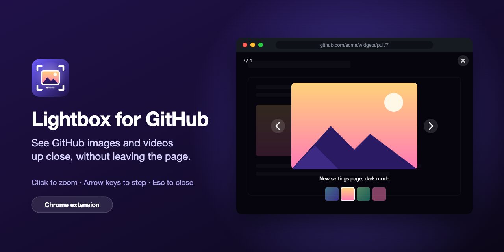

# Lightbox for GitHub



A Chrome extension. It opens images and videos from GitHub issues and pull requests in a full-screen lightbox on the same page.

## Install

Install it from the Chrome Web Store. The store link comes with the first release there.

Chrome 132 or newer is needed. The extension collects no data and asks for no permissions. `PRIVACY.md` has the details.

## Use

On an issue or a pull request:

- Click an image in a comment. It grows into the lightbox from its place on the page.
- Point at a video. Click the expand button at its top right.
- Press the left and right arrow keys, or click the arrow buttons, to move through the media of that comment.
- Click a thumbnail to jump to it.
- Press Escape, click the X, or click the dark background to close. The media shrinks back to its place.

Cmd-click and Ctrl-click on an image still open a new tab. A click on a video still plays it.

## Develop

To run your local copy:

1. Open `chrome://extensions`.
2. Turn on Developer mode.
3. Click Load unpacked and pick the `extension/` folder.

The extension has no build step and no dependencies. You need Node for the tests only.

```
npm install
npm run check
npm test
npm run e2e
npm run verify:live
npm run verify:lifecycle
npm run package
npm run store:assets
```

- `npm run check` type-checks the `// @ts-check` sources with `tsc`.
- `npm test` runs the unit tests with `node --test`.
- `npm run e2e` loads the unpacked extension in Chromium on copies of GitHub pages.
- `npm run verify:live` drives the public test issue and pull request on github.com, and saves screenshots and video to `.verify/`.
- `npm run verify:lifecycle` checks every state of the lightbox lifecycle for galleries of 1 to 8 items.
- `npm run package` builds `dist/gh-lightbox-v<version>.zip`, the file for the Chrome Web Store. It fails if the zip holds a file that does not belong.
- `npm run store:assets` builds the store screenshots and promo tile in `store/`, and the README banner.

CI runs `check`, `test`, `verify:lifecycle`, `package`, and `e2e` on every pull request, and checks that the manifest version matches `package.json`. It skips `verify:live`, which needs the public test pages.

Agents: `.claude/skills/verify-gh-lightbox` and `.claude/skills/verify-lightbox-lifecycle` describe how to prove a change.

## Release

Add a changeset to each pull request that changes the extension: run `npx changeset`, pick the bump, and describe the change. After a merge to `main`, the Release workflow opens a "chore: version packages" pull request. A merge of that pull request bumps the version in `package.json` and `extension/manifest.json`, updates `CHANGELOG.md`, pushes a `vX.Y.Z` tag, and creates a GitHub release. The release lists each change with its pull request and author, and holds the extension as a zip file.

`store/listing.md` holds the Chrome Web Store listing text and the answers for the privacy tab.

`docs/design.md` explains the design. `test/e2e/make-fixtures.sh` rebuilds the test media with ffmpeg.

## License

MIT. See `LICENSE`.
