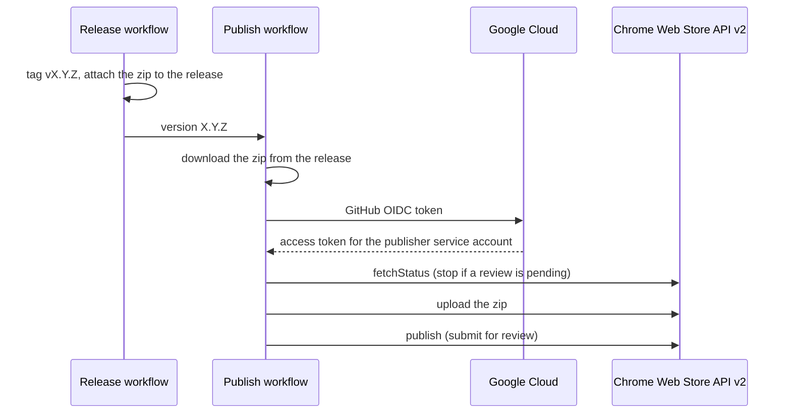

# Publishing to the Chrome Web Store

The Release workflow creates a GitHub release with the extension zip. Then it calls the "Publish to Chrome Web Store" workflow (`.github/workflows/publish-store.yml`). That workflow uploads the same zip to the store, and submits it for review. The new version goes live when the review approves it.



No key or password is stored anywhere. GitHub gives each run an OIDC token. Google trusts that token only for the `main` branch of `brunojppb/gh-lightbox`, and exchanges it for a short-lived access token of a service account. The store dashboard lists that service account as allowed to publish.

## One-time setup

You need the `gcloud` CLI, signed in with the Google account that owns the store publisher. Run these commands one block at a time.

1. Create a Google Cloud project, and turn on the APIs.

   ```sh
   PROJECT_ID=gh-lightbox-publish
   gcloud projects create "$PROJECT_ID"
   gcloud services enable chromewebstore.googleapis.com iamcredentials.googleapis.com sts.googleapis.com --project "$PROJECT_ID"
   ```

2. Create the service account. It needs no project roles.

   ```sh
   gcloud iam service-accounts create cws-publisher --display-name "Chrome Web Store publisher" --project "$PROJECT_ID"
   SA_EMAIL="cws-publisher@$PROJECT_ID.iam.gserviceaccount.com"
   ```

3. Let GitHub Actions on `main` of this repository act as the service account.

   ```sh
   gcloud iam workload-identity-pools create github --location global --project "$PROJECT_ID"
   gcloud iam workload-identity-pools providers create-oidc gh-lightbox \
     --location global --workload-identity-pool github --project "$PROJECT_ID" \
     --issuer-uri https://token.actions.githubusercontent.com \
     --attribute-mapping 'google.subject=assertion.sub,attribute.repository=assertion.repository,attribute.ref=assertion.ref' \
     --attribute-condition "assertion.repository == 'brunojppb/gh-lightbox' && assertion.ref == 'refs/heads/main'"
   PROJECT_NUMBER=$(gcloud projects describe "$PROJECT_ID" --format 'value(projectNumber)')
   POOL="projects/$PROJECT_NUMBER/locations/global/workloadIdentityPools/github"
   gcloud iam service-accounts add-iam-policy-binding "$SA_EMAIL" --project "$PROJECT_ID" \
     --role roles/iam.workloadIdentityUser \
     --member "principalSet://iam.googleapis.com/$POOL/attribute.repository/brunojppb/gh-lightbox"
   ```

4. In the [developer dashboard](https://chrome.google.com/webstore/devconsole), open **Account**, and add the service account email (`$SA_EMAIL`). A publisher can have one service account.

5. In the dashboard, open **Publisher > Settings**, and copy the publisher ID.

6. Set the repository variables. None of them is a secret.

   ```sh
   gh variable set CWS_PUBLISHER_ID --body "<publisher ID from step 5>"
   gh variable set CWS_ITEM_ID --body icoilmbldibbgblbalabppdipkpgkodi
   gh variable set CWS_SERVICE_ACCOUNT --body "$SA_EMAIL"
   gh variable set GCP_WORKLOAD_IDENTITY_PROVIDER --body "$POOL/providers/gh-lightbox"
   ```

Until `CWS_PUBLISHER_ID` is set, the publish job skips, and the release still succeeds.

## When a publish fails

The workflow log says why. The usual reasons:

- **A review is still pending.** The store reviews one submission at a time. Wait for the review to finish, then run "Publish to Chrome Web Store" from the Actions tab with the version. To replace the version in review instead, cancel its submission in the dashboard first.
- **HTTP 403.** Check step 4 (the service account in the dashboard) and the repository variables.
- **The version is not higher.** The store accepts only a version higher than the last upload. Changesets raises the version, so this happens only if someone uploaded a version by hand.

To publish a release again, open **Actions > Publish to Chrome Web Store > Run workflow**, keep the `main` branch, and enter the version, such as `0.3.0`. Google accepts the token only from `main`.
